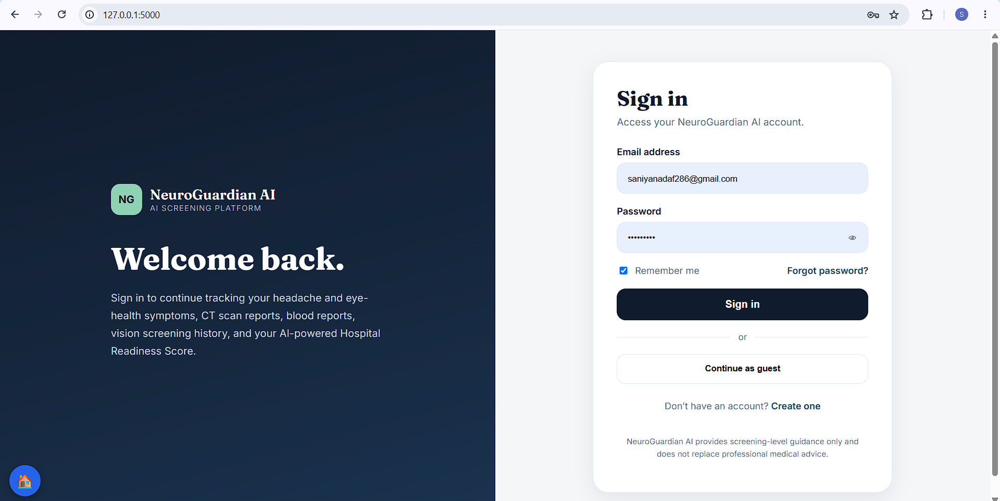
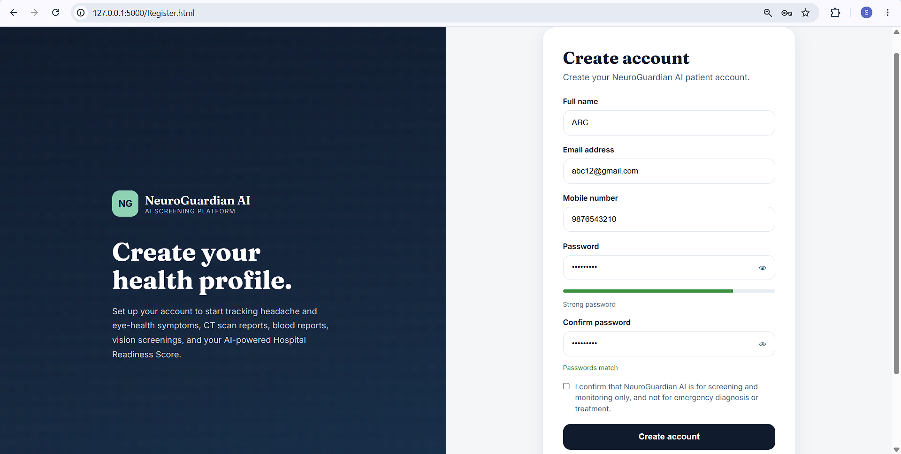
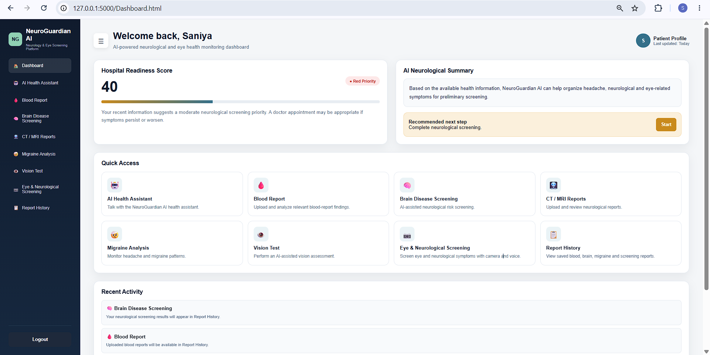
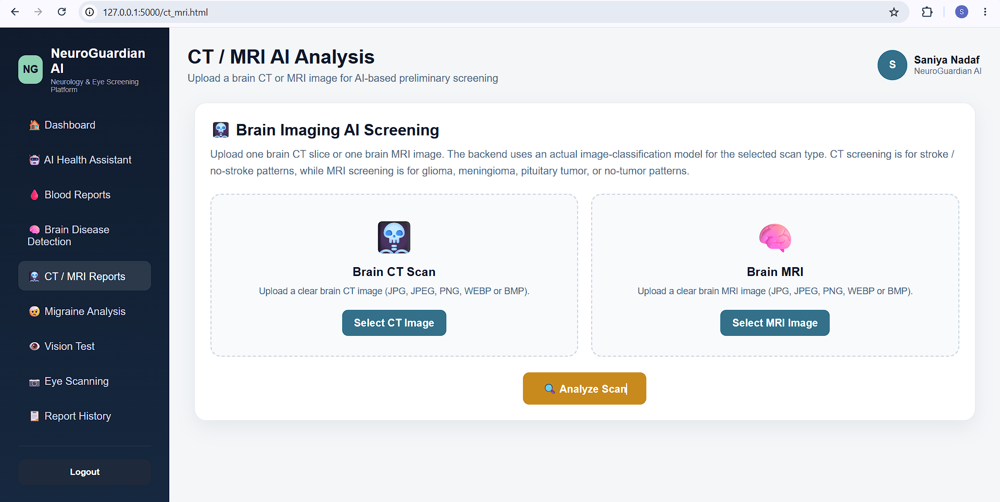

\# NeuroGuardian AI


\## About the Project

NeuroGuardian AI is a software-based healthcare screening project designed to help users understand potential neurological and eye-health risks based on symptoms and available health information.


\*\*Note:\*\* This project is intended for screening and educational purposes only. It does not provide a medical diagnosis.


\## Key Features

\- User login and registration pages

\- Symptom-based screening

\- Headache and migraine analysis

\- Eye and vision screening

\- Brain disease information

\- CT/MRI scan-related pages

\- Blood report interface

\- AI chatbot interface

\- Dashboard and report history


\## Technologies Used

\- Python

\- HTML, CSS and JavaScript

\- SQLite database

\- AI/ML tools (as implemented in the project)


\## Project Structure

\- `app.py` — Python application

\- `app\_final.py` — Alternative/final application script

\- `Dashboard.html` — Dashboard page

\- `Login.html` — Login page

\- `Register.html` — Registration page

\- `ai\_chat.html` — Chatbot interface

\- `database/` — Database files

\- `screenshots/` — Project screenshots


\## How to Run

1\. Clone or download this repository.

2\. Open the project folder in a terminal.

3\. Install the dependencies listed in `requirements.txt`, if provided.

4\. Run the appropriate application script after configuring its dependencies.


Example:


```bash

python app.py

```


The exact startup steps may depend on the installed libraries and project configuration.


\## Disclaimer

NeuroGuardian AI is a student project and is not a substitute for professional medical advice, diagnosis, or treatment.

## Project Screenshots

### 1. Login Page


### 2. Registration Page


### 3. Dashboard


### 4. CT/MRI Scan Page


\## Author

Saniya Ibrahim Nadaf and project team


Brahmdevdada Mane Institute of Technology, Solapur, Maharashtra, India

